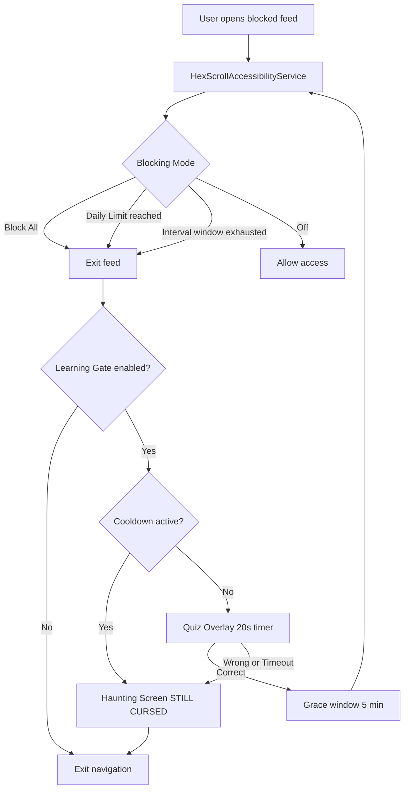

# HexScroll

> Block Reels and Shorts and other forms of addictive content. Answer questions to unlock access or face the haunting.

<p align="center">
  
</p>

<p align="center">
  <a href="https://github.com/i-mwangi/rotward/releases"></a>
  <a href="https://kotlinlang.org"></a>
  <a href="https://developer.android.com/compose"></a>
  <a href="https://github.com/i-mwangi/rotward/releases"></a>
  
</p>

<p align="center">
  <a href="https://github.com/i-mwangi/rotward/releases">Download APK</a> &nbsp;&bull;&nbsp;
  <a href="#features">Features</a> &nbsp;&bull;&nbsp;
  <a href="#install">Install</a> &nbsp;&bull;&nbsp;
  <a href="#build-from-source">Build</a>
</p>

---

## About

**HexScroll** is an offline-first Android app that uses an Accessibility Service to monitor and block short-form video feeds on Instagram Reels, YouTube Shorts, TikTok, and Facebook Reels.

An optional **Learning Gate** intercepts every blocked feed with a quiz from your chosen topics. Answer correctly and earn a 5-minute grace window. Answer wrong and face the **Haunting Screen** — spooky images, alarm-volume audio that ignores silent mode, glitch text, and an unskippable countdown.

> *The feed wants your attention. HexScroll wants it back.*

---

## Features

### Blocking Modes

HexScroll gives you four blocking strategies. Pick the one that matches how strict you want to be with yourself:

| Mode | Description | Use When |
|---|---|---|
| **Block All** | Instant exit every time you open a blocked feed | You want zero tolerance |
| **Daily Limit** | Cumulative daily cap across all blocked apps | You want controlled access |
| **Interval Timer** | Short usage windows with forced breaks | You want scheduled access |
| **Off** | Service runs but never blocks | You just want usage tracking |

### Learning Gate

Instead of a cold block, HexScroll intercepts the feed with an offline multiple-choice question from your chosen topics. Every scroll attempt has a learning cost.

**Topics available:** Programming and CS · World History · Math and Logic · General Science · Languages · Personal Finance

| Outcome | What happens |
|---|---|
| Correct answer | 5-minute grace window granted, overlay dismisses, feed stays open |
| Wrong answer or timeout | Haunting Screen fires, 3-minute cooldown set |
| Cooldown retry | Quiz skipped entirely, Haunting Screen fires immediately |

Questions use spaced repetition — cards you answer wrong come up more often until you get them right.

### Haunting Screen

The penalty for getting it wrong is designed to be memorable. It is not skippable.

| Feature | Detail |
|---|---|
| Visuals | Random spooky image from asset pool: bats, skulls, pumpkins, animated GIF |
| Audio | Random sound played at maximum alarm volume — bypasses silent and vibrate mode |
| Effects | Chromatic aberration glitch text, CRT scanlines, screen flicker |
| Back button | Locked — consuming KEYCODE_BACK so you cannot dismiss early |
| Duration | 5-second countdown on wrong answer, 3-second on cooldown retry |

### Usage Tracking

HexScroll tracks time spent per app and surfaces it on the home screen so you can see your habits clearly.

- Live **segmented donut chart** with one arc per app — Reels, Shorts, TikTok, FB Reels
- Each arc animates from 0 when you open the app
- Floating **timer overlay** appears on top of the blocked app showing remaining allowed time
- Grace window and cooldown status shown as a pill below the donut
- All daily counters reset automatically at midnight

**Supported apps:** Instagram Reels · YouTube Shorts · TikTok · Facebook Reels

---

## Architecture

HexScroll uses Clean Architecture with 5 Gradle modules. Each module has strict dependency rules — the domain layer has no Android or Room imports, and the design system has no domain dependencies.



---

## Project Structure

```
HexScroll/
├── .kiro/                        # Kiro spec directory
│   ├── specs/hexscroll-core/     # Blocking, learning gate, haunting spec
│   ├── specs/readme-and-onboarding/
│   ├── hooks/                    # Code quality and build hooks
│   └── steering/                 # Persistent project context
├── core/
│   ├── logging/                  # Timber DebugLogTree and ReleaseLogTree
│   ├── domain/                   # Models, blocking handlers, LearningGateCoordinator
│   ├── data/                     # Room v1, DAOs, 120 MCQs, UserSettingsStore
│   └── designsystem/             # Dark theme, HauntEffects, SegmentedProgress
└── mobile/
    ├── accessibility/            # HexScrollAccessibilityService
    ├── ui/home/                  # HomeScreen, donut ring, mode cards, dialogs
    ├── ui/topics/                # TopicPickerScreen
    ├── ui/overlay/               # Quiz and haunting overlay engine
    └── assets/haunt/             # Spooky images and sounds
```

---

## Available Commands

| Command | What it does |
|---|---|
| `./gradlew :mobile:assembleDebug` | Build debug APK |
| `./gradlew :mobile:assembleRelease` | Build release APK |
| `./gradlew :core:domain:test` | Run domain unit tests |
| `./gradlew :core:data:testDebugUnitTest` | Run data layer tests including question pack validation |
| `./gradlew :core:designsystem:assembleDebug` | Build design system module |
| `./gradlew --stop` | Stop all Gradle daemons |

---

## Recent Updates

### v1.3.0
- README with install guide, Mermaid architecture diagram, and phone-specific background service fix

### v1.2.0
- Custom launcher icon: crimson brain with circuit lines and padlock
- Logo GIF added to haunting screen image pool

### v1.1.0
- Donut progress ring on home screen with per-app animated arcs
- Mode cards: Block All, Daily Limit, Interval, Off
- Daily Limit and Interval Timer configuration dialogs
- Haunting media: random images and sounds at alarm volume
- Answer feedback: 700ms green/red flash before overlay transitions

---

## Screenshots

*Screenshots coming soon*

```
+-----------------------+  +-----------------------+  +-----------------------+
|                       |  |                       |  |                       |
|   Home Screen         |  |   Quiz Overlay        |  |   Haunting Screen     |
|   Donut ring +        |  |   20s timer bar +     |  |   Glitch text +       |
|   mode cards          |  |   4 answer options    |  |   spooky image        |
|                       |  |                       |  |                       |
+-----------------------+  +-----------------------+  +-----------------------+
```

---

## Install

> **Seeing "blocked to protect your device" on Infinix or other phones?**
> This is **not** a virus warning. It means **Install unknown apps** is turned off. Follow step 2.

**Step 1:** Download the latest APK from [**Releases**](https://github.com/i-mwangi/rotward/releases)

**Step 2:** Enable sideloading
Settings then Security then Install unknown apps — enable for WhatsApp or your file manager

**Step 3:** Open the APK and tap **Install**

**Step 4:** Open HexScroll, complete the topic picker, enable the accessibility service when prompted

Requires **Android 8.0+** (API 26)

---

## Keeping the accessibility service alive

Some phones kill background apps when you swipe them from recent apps. This stops the accessibility service and **HexScroll stops blocking**.

**Universal fix:**

1. Open Accessibility settings, turn HexScroll off and back on
2. Tap **Allow background activity** for HexScroll and confirm the popup

**Phone-specific steps:**

| Manufacturer | Steps |
|---|---|
| **Infinix / Tecno / itel** | Settings then Battery then Power saving — turn off Ultra power saving for HexScroll |
| **Xiaomi / Redmi / POCO** (MIUI, HyperOS) | Turn on Autostart and set Battery saver to No restrictions |
| **Huawei / Honor** | App launch — Manage manually — Auto-launch ON + Run in background ON |
| **Oppo / Realme / OnePlus** | Allow auto launch + Allow background activity |
| **Vivo / iQOO** | Auto-start ON + Allow high background power consumption |
| **Samsung** | Battery usage — Unrestricted + remove from Sleeping apps |

---

## Tech Stack

| Category | Technology | Purpose |
|---|---|---|
| **Language** | Kotlin 2.x, JDK 17 | Primary language with coroutines |
| **UI** | Jetpack Compose + Material 3 | Declarative dark-theme UI |
| **DI** | Hilt via KSP | Dependency injection |
| **Database** | Room v1 | Offline-first persistence |
| **Concurrency** | Kotlin Coroutines + Flow | Reactive state management |
| **Images** | Coil 2.7 | PNG and GIF loading in overlays |
| **Logging** | Timber | Debug and release log trees |
| **Network** | None | 100% offline, no accounts required |

---

## Build from source

```bash
git clone https://github.com/i-mwangi/rotward.git
cd rotward
./gradlew :mobile:assembleDebug
```

APK: `mobile/build/outputs/apk/debug/mobile-debug.apk`

Run tests:

```bash
./gradlew :core:domain:test :core:data:testDebugUnitTest
```

---

## Contributing

1. Fork the repository
2. Create a feature branch: `git checkout -b feature/YourFeature`
3. Commit your changes: `git commit -m 'Add YourFeature'`
4. Push to the branch: `git push origin feature/YourFeature`
5. Open a Pull Request

---

## Acknowledgements

- **Kiro** — this entire project was specified and built using [Kiro](https://kiro.dev), an AI-powered IDE. The `.kiro` directory contains the full spec.
- **Jetpack Compose** team for making Android UI bearable
- **Room** and **Hilt** for making offline-first Android development straightforward
- Everyone who keeps opening Reels and making this app necessary

---

## License

MIT License

---

<p align="center"><em>Less scrolling. More living. Answer the question.</em></p>

<p align="center"><a href="#">Back to Top</a></p>
